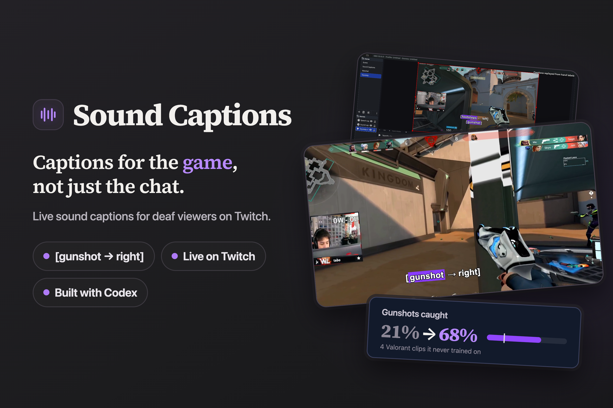

# Sound Captions

**Captions for the game, not just the chat.**



Sound Captions turns game audio into short, directional captions such as `[gunshot → right]` for Twitch viewers. A local Python helper sends sound events to an OBS browser overlay. Viewers do not need an extension.

I used to stream Valorant on Twitch, and I still watch it. Speech captions can tell you what the streamer said, but leave out the offscreen sounds that explain the game. This prototype adds those sounds to the broadcast.

## Start here

| What you want | Where to look |
| --- | --- |
| Project story / submission | [Devpost write-up](docs/DEVPOST.md) |
| Browser overlay | [`overlay/`](overlay/), [overlay guide](docs/OVERLAY.md) |
| Live inference / OBS media following | [`live_helper.py`](live_helper.py), [helper guide](docs/LIVE_HELPER.md) |
| Annotation and model correction UI | [`labeler.py`](labeler.py), [`labeler-ui/`](labeler-ui/) |
| Selected model and provenance | [`models/`](models/), [`live-config.json`](live-config.json) |
| Final held-out results | [`evaluations/final-valorant-selected.json`](evaluations/final-valorant-selected.json) |
| Experiment history | [`rounds.md`](rounds.md), [`training/`](training/) |
| Detailed development notes | [Development guide](docs/DEVELOPMENT.md) |

## Quick start

Requires **Python 3.11**, **FFmpeg / ffprobe** on PATH, and OBS for streaming. Tested locally on macOS; Windows audio routing needs validation.

```sh
python3.11 -m venv .venv-model
source .venv-model/bin/activate
pip install -r requirements-runtime.txt
python scripts/setup_models.py
python live_helper.py --help
```

On Windows, use `.venv-model\Scripts\activate` to activate the environment. The bundled YAMNet encoder and selected classifier are checked against their recorded SHA-256 hashes. No paid API or Twitch credentials are needed.

### Caption a local gameplay recording

```sh
python live_helper.py --file /absolute/path/to/your-gameplay.mp4
```

The helper analyzes the recording at normal speed; it does not play the video. Add this **Browser Source** above your gameplay in OBS, sized **1920 × 1080**:

```text
http://127.0.0.1:8771/overlay
```

### Follow an OBS Media Source

Enable OBS's WebSocket server. Copy `.env.example` to `.env` and set `OBS_WS_PASSWORD` locally, then run:

```sh
python live_helper.py --list-obs-inputs
python live_helper.py --obs-media 'Your Media Source Name'
```

### Use a live game-audio bus

Route game audio to an explicit stereo input / loopback device, then select it:

```sh
python live_helper.py --list-devices
python live_helper.py --device 7
```

Replace `7` with your actual device ID. Audio routing is manual; the helper does not automatically capture a game's process. See the [helper guide](docs/LIVE_HELPER.md) for timing and routing limitations.

### Replay hand labels, as in the demo

Place a CSV next to your own recording, with columns `start_s,end_s,label,direction`. Optional same-named SRT files provide speech subtitles.

```sh
python live_helper.py --obs-media 'Your Media Source Name' --replay-labels
```

**The demo replays human annotations; it is not a live-model accuracy demonstration.** This mode follows OBS pause, seek, and restart. Inference mode runs without `--replay-labels`.

## Results and limitations

The selected round-2 model was tested on **four held-out Valorant clips**, using original mixed audio with speech still present. Both before and after scores use the same final caption policy.

| Measure | Plain YAMNet | Selected model |
| --- | ---: | ---: |
| Non-centered sound recall | 20% (4/20) | **65% (13/20)** |
| Gunshot recall | 21% (4/19) | **68% (13/19)** |
| Recall during speech | 15% (2/13) | **62% (8/13)** |
| Recall without speech | 29% (2/7) | **71% (5/7)** |
| False captions per minute | 2.62 | **10.94** |

These are **recall**, not overall accuracy. The test is small and excludes centered sounds from the primary denominator. Footsteps were missed (0/1 eligible event). Five of six scored direction arrows were correct, with arrows supplied for six of 13 matched directional events. Reload captions are disabled in model mode. The model catches more sounds but also emits more false captions.

The final selected report is [`evaluations/final-valorant-selected.json`](evaluations/final-valorant-selected.json). Other evaluation files are retained as historical experiments, not additional evidence for the headline claim.

## How it works

```text
Stereo game audio → YAMNet embeddings → trained classifier → caption policy
         └──────── left/right level estimate ────────────────┘
                                   ↓
                         local WebSocket → OBS overlay
```

The classifier recognizes sounds from mono embeddings; direction comes separately from stereo levels. The overlay shows up to two captions for up to three seconds. Codex built the labeling workflow, training/evaluation tools, helper, and overlay; I supplied clips, labels, corrections, and product decisions.

## Development and tests

```sh
pip install -r requirements-model.txt
python labeler.py
python -m unittest discover -s tests -v
```

The labeler opens at `http://127.0.0.1:8765`. Training uses whole-clip splits and separate held-out evaluation. Existing experiment scripts protect frozen artifacts; do not rerun them to overwrite recorded results. The [results guide](docs/RESULTS.md) distinguishes the selected comparison from historical experiments.

## Included and excluded

Included: source, tests, annotation CSV/SRT files, model/configuration artifacts, experiment results, and third-party attribution. Gameplay video/audio, secrets, environments, and temporary caches are excluded. Original clip links are listed in [`test-audio/real-clips/README.md`](test-audio/real-clips/README.md); supply your own recordings to try the helper. Training reproduction also requires the original media and local review/augmentation state described in the development log.

YAMNet is provided under Apache 2.0; see [model attribution](models/README.md) and [license](third_party/YAMNet-LICENSE). Historical EfficientAT attribution and Xonotic sound-license notes are retained; those model weights and sound recordings are not bundled.
